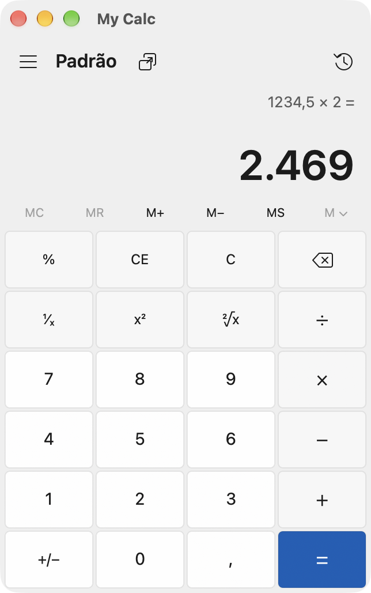

# My Calc

**Português (Brasil)** · [English](docs/readme/en.md) · [Español](docs/readme/es.md) · [Français](docs/readme/fr.md) · [Deutsch](docs/readme/de.md) · [Italiano](docs/readme/it.md) · [日本語](docs/readme/ja.md) · [한국어](docs/readme/ko.md)

**Suíte My:** [My Explorer](https://github.com/leoars/my-explorer/blob/main/README.pt-BR.md) · [My Notepad](https://github.com/leoars/My-Notepad) · [My Paint](https://github.com/leoars/my-paint) · **My Calc**

Uma calculadora simples para macOS. Faça a conta no modo padrão, científico ou de programador, com as teclas e os atalhos que suas mãos já conhecem.

## Baixar para macOS

- **[Baixar para Apple Silicon (série M)](https://github.com/leoars/my-calc/releases/download/1.0/My-Calc-1.0-arm64.pkg)**
- **[Baixar para Intel](https://github.com/leoars/my-calc/releases/download/1.0/My-Calc-1.0-x86_64.pkg)**

Requer macOS 12 ou posterior. [Ver a versão mais recente](https://github.com/leoars/my-calc/releases/latest)

Para instalar o My Explorer, o My Notepad, o My Paint e o My Calc de uma vez, use o [instalador da suíte My](https://github.com/leoars/my-suite).



## Por que este projeto existe?

O My Calc nasceu da mesma ideia do My Notepad e do My Paint: uma calculadora que cabe num canto da tela, com o visor em cima, a memória no meio e as teclas embaixo, e que responde ao teclado do computador sem que seja preciso procurar nada. O projeto entrega esse jeito de trabalhar em Swift e AppKit, sem dependências externas. A aritmética é própria e decimal, então 0,1 + 0,2 dá 0,3. Teclas, visor e ícone foram desenhados do zero.

## Funcionalidades

### Padrão

- As quatro operações, **%**, **¹⁄ₓ**, **x²**, **²√x** e **+/−**, na ordem em que as teclas são pressionadas: `1 + 2 × 3 =` dá 9.
- **=** de novo repete a última operação; um operador logo depois de outro o substitui.
- **⌫** apaga o último dígito, **CE** limpa o número e **C** limpa a conta.
- A conta em andamento aparece numa linha acima do número, e fica lá com o resultado.

### Científica

- Respeita a precedência dos operadores e os parênteses: `1 + 2 × 3 =` dá 7.
- **Trigonometria**: sin, cos, tan, sec, csc e cot, as inversas e as hiperbólicas, em graus, radianos ou grados (**DEG**, **RAD**, **GRAD**).
- **x²**, **²√x**, **xʸ**, **10ˣ**, **log** e **ln**; com **2ⁿᵈ**, **x³**, **³√x**, **ʸ√x**, **2ˣ**, **logᵧx** e **eˣ**.
- **n!**, também para números não inteiros, **|x|**, **π**, **e**, **mod** e **exp** para digitar o expoente de dez.
- **Função**: ⌊x⌋, ⌈x⌉, rand e a conversão entre graus decimais e graus, minutos e segundos.
- **F-E** mostra o resultado em notação científica.


### Programador

- O número aparece ao mesmo tempo em **HEX**, **DEC**, **OCT** e **BIN**; um clique numa das linhas escolhe a base de digitação.
- Palavras de 64, 32, 16 ou 8 bits (**QWORD**, **DWORD**, **WORD**, **BYTE**) em complemento de dois.
- **<<**, **>>** e o menu **Bit a bit** (AND, OR, NOT, NAND, NOR, XOR, RoL e RoR), com precedência e parênteses.
- Painel com os 64 bits do número no lugar das teclas; um clique num bit o inverte.


### Memória e histórico

- **MS** guarda o número numa lista; **MR** traz o mais recente, **M+** e **M−** somam e subtraem nele e **MC** esvazia a lista. **M** abre a lista sobre as teclas: um clique num número o traz de volta.
- O botão do relógio (`Ctrl+H`) abre o histórico das contas dos modos padrão e científico, com o resultado de cada uma; um clique numa linha traz o resultado de volta e a lixeira limpa a lista.
- **Copiar** leva o número do visor. **Colar** digita o que estiver na área de transferência, seja um número, com ponto ou vírgula, ou uma conta inteira como `2+3*4=`.

### Números

- Aritmética decimal com 32 dígitos significativos no visor: nada de 0,30000000000000004.
- Números até 10 elevado a 10000; o que não cabe em 32 dígitos aparece em notação científica.
- O que é exato sai exato: o seno de 30° é 0,5, o logaritmo de 1000 é 3 e a raiz de 2 ao quadrado é 2.
- Dígitos agrupados e separador decimal com os sinais da sua região; o agrupamento pode ser desligado.
- Erros dizem o que houve: divisão por zero, resultado indefinido, entrada inválida e estouro.

### Interface e idiomas

- O botão de três linhas troca de modo e leva aos **Ajustes…**; os mesmos comandos estão na barra de menus do macOS.
- Aparência clara ou escura, conforme o sistema, e janela redimensionável: as teclas crescem com ela.
- **Manter no topo** deixa a calculadora acima das outras janelas.
- O modo, a unidade de ângulo, o agrupamento de dígitos e a posição da janela são lembrados.
- Disponível em português, inglês, espanhol, francês, alemão, italiano, japonês e coreano.
- **Verificar atualizações…** no menu My Calc, e uma verificação ao abrir, no máximo uma vez por dia, que pode ser desligada em **Ajustes…**. A versão nova só é baixada com a sua confirmação, é conferida (assinatura do desenvolvedor e notarização da Apple) e abre no Instalador do macOS; o My Calc reabre quando o Instalador termina.

### Atalhos

O teclado numérico e as teclas de sempre funcionam; os comandos de menu usam `Cmd`.

| Teclas | Ação |
| --- | --- |
| `0`–`9` · `,` ou `.` · `+` `-` `*` `/` | Dígitos, separador decimal e operações |
| `Enter` ou `=` · `Backspace` · `Delete` · `Esc` | Igual, apagar um dígito, CE e C |
| `F9` · `R` · `Q` · `@` · `%` | Trocar o sinal, ¹⁄ₓ, x², ²√x e porcentagem |
| `Ctrl+L` · `Ctrl+R` · `Ctrl+M` · `Ctrl+P` · `Ctrl+Q` | MC, MR, MS, M+ e M− |
| `Option+1` a `Option+3` (ou `Cmd+1` a `Cmd+3`) | Padrão, científica e programador |
| `Ctrl+H` (ou `Cmd+Y`) · `Ctrl+Shift+D` | Abrir o histórico e limpá-lo |
| `Cmd+C` · `Cmd+V` · `Cmd+T` | Copiar, colar e manter no topo |
| `S` · `O` · `T` · `U` · `I` · `J` | sin, cos, tan, sec, csc e cot; com `Shift`, as inversas |
| `Ctrl+S` · `Ctrl+O` · `Ctrl+T` | sinh, cosh e tanh |
| `N` · `Ctrl+N` · `L` · `Ctrl+G` | ln, eˣ, log e 10ˣ |
| `#` · `Y` · `Ctrl+B` · `Ctrl+Y` · `!` | x³, xʸ, ³√x, ʸ√x e n! |
| `P` · `E` · `X` · `D` · `M` · `V` · `(` `)` | π, e, exp, mod, graus-minutos-segundos, F-E e parênteses |
| `\|` · `[` · `]` | \|x\|, ⌊x⌋ e ⌈x⌉ |
| `F3` · `F4` · `F5` | DEG, RAD e GRAD (científica) |
| `F5` · `F6` · `F7` · `F8` | HEX, DEC, OCT e BIN (programador) |
| `F12` · `F2` · `F3` · `F4` | QWORD, DWORD, WORD e BYTE (programador) |
| `&` · `\|` · `^` · `~` · `.` · `,` | AND, OR, XOR, NOT, NAND e NOR (programador) |
| `<` · `>` · `J` · `K` · `%` | <<, >>, RoL, RoR e resto da divisão (programador) |

## Parte da suíte My

O My Calc faz parte da suíte My: aplicativos para macOS simples e diretos, com os menus e os atalhos de sempre.

- **My Calc** (este repositório): calculadora simples.
- **[My Explorer](https://github.com/leoars/my-explorer/blob/main/README.pt-BR.md)**: gerenciador de arquivos com árvore de pastas, abas e barra de comandos.
- **[My Notepad](https://github.com/leoars/My-Notepad)**: editor de texto simples.
- **[My Paint](https://github.com/leoars/my-paint)**: editor de imagens simples.
- **[My Suite](https://github.com/leoars/my-suite)**: o instalador que reúne os quatro aplicativos, com a escolha de quais instalar.

## Compilar e instalar no Mac

Os instaladores têm como alvo o macOS 12 ou posterior, em Apple Silicon e Intel. Para compilar, use as ferramentas de desenvolvimento da Apple com o compilador Swift. Na raiz do projeto, execute:

```sh
./build.sh
open "My Calc.app"
```

Para rodar os testes automáticos:

```sh
./test.sh
```

Para gerar os dois instaladores, execute o comando abaixo. Em `dist/`, escolha o pacote `arm64` para Apple Silicon ou `x86_64` para Intel. Abra o arquivo `.pkg` para instalar o aplicativo em `/Applications`.

```sh
./package.sh
```

O ícone é desenhado em código por `Tools/icon.swift`; para gerá-lo de novo, execute `swift Tools/icon.swift Resources/MyCalc.icns`.

## Como contribuir

O motor de cálculo fica em [Sources](Sources), separado da interface: `BigDecimal.swift` (o número decimal), `BigMath.swift` (as funções) e `Calculator.swift` (as teclas). Os testes ficam em [Tests](Tests) e as [traduções](Resources) em pastas `.lproj`, uma por idioma. Ao relatar um resultado errado, inclua a versão do macOS, o modo, a sequência de teclas e o que apareceu no visor.

## Licença

O código e a documentação originais são distribuídos sob a [Apache License 2.0](LICENSE). Veja [THIRD_PARTY_NOTICES.md](THIRD_PARTY_NOTICES.md).
