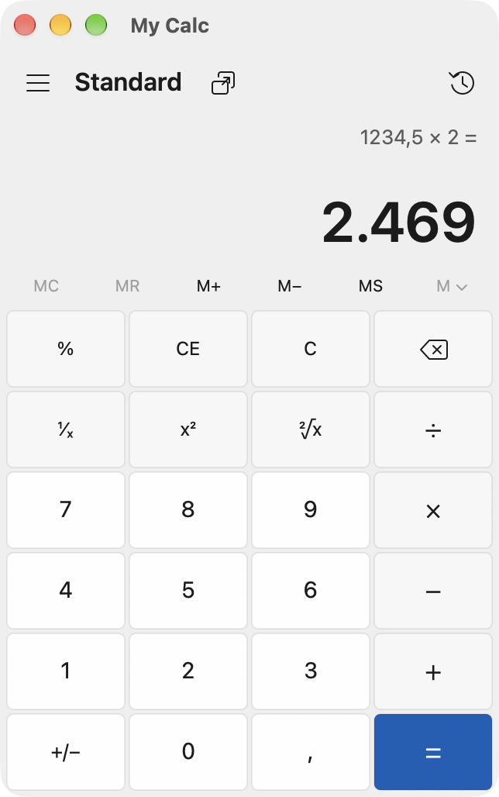

# My Calc

[Português (Brasil)](../../README.md) · [English](en.md) · [Español](es.md) · [Français](fr.md) · **Deutsch** · [Italiano](it.md) · [日本語](ja.md) · [한국어](ko.md)

**My-Suite:** [My Explorer](https://github.com/leoars/my-explorer/blob/main/README.de.md) · [My Notepad](https://github.com/leoars/My-Notepad/blob/main/docs/readme/de.md) · [My Paint](https://github.com/leoars/my-paint/blob/main/docs/readme/de.md) · **My Calc**

Ein einfacher Rechner für macOS. Rechne im Standard-, im wissenschaftlichen oder im Programmierermodus – mit den Tasten und Tastenkürzeln, die du schon kennst.

## Download für macOS

- **[Für Apple Silicon (M-Serie) herunterladen](https://github.com/leoars/my-calc/releases/download/1.0/My-Calc-1.0-arm64.pkg)**
- **[Für Intel herunterladen](https://github.com/leoars/my-calc/releases/download/1.0/My-Calc-1.0-x86_64.pkg)**

Erfordert macOS 12 oder neuer. [Zur neuesten Version](https://github.com/leoars/my-calc/releases/latest)

Um My Explorer, My Notepad, My Paint und My Calc auf einmal zu installieren, nutze das [Installationsprogramm der My-Suite](https://github.com/leoars/my-suite/blob/main/docs/readme/de.md).



## Warum gibt es dieses Projekt?

My Calc entstand aus derselben Idee wie My Notepad und My Paint: ein Rechner, der in eine Ecke des Bildschirms passt, mit der Anzeige oben, dem Speicher in der Mitte und den Tasten unten, und der auf die Tastatur des Computers reagiert, ohne dass man etwas suchen muss. Das Projekt bietet diese Arbeitsweise mit Swift und AppKit, ohne externe Abhängigkeiten. Die Arithmetik ist eine eigene und dezimal, also ergibt 0,1 + 0,2 genau 0,3. Tasten, Anzeige und Symbol wurden von Grund auf neu gezeichnet.

## Funktionen

### Standard

- Die vier Grundrechenarten, **%**, **¹⁄ₓ**, **x²**, **²√x** und **+/−**, in der Reihenfolge, in der die Tasten gedrückt werden: `1 + 2 × 3 =` ergibt 9.
- Ein weiteres **=** wiederholt die letzte Rechenoperation; ein Operator direkt nach einem anderen ersetzt ihn.
- **⌫** löscht die letzte Ziffer, **CE** löscht die Zahl und **C** löscht die Rechnung.
- Die laufende Rechnung erscheint in einer Zeile über der Zahl und bleibt dort mit dem Ergebnis stehen.

### Wissenschaftlich

- Beachtet die Rangfolge der Operatoren und die Klammern: `1 + 2 × 3 =` ergibt 7.
- **Trigonometrie**: sin, cos, tan, sec, csc und cot, die Umkehrfunktionen und die Hyperbelfunktionen, in Grad, Bogenmaß oder Gon (**DEG**, **RAD**, **GRAD**).
- **x²**, **²√x**, **xʸ**, **10ˣ**, **log** und **ln**; mit **2ⁿᵈ** auch **x³**, **³√x**, **ʸ√x**, **2ˣ**, **logᵧx** und **eˣ**.
- **n!**, auch für nicht ganze Zahlen, **|x|**, **π**, **e**, **mod** und **exp** zur Eingabe des Zehnerexponenten.
- **Funktion**: ⌊x⌋, ⌈x⌉, rand und die Umrechnung zwischen Dezimalgrad und Grad, Minuten und Sekunden.
- **F-E** zeigt das Ergebnis in wissenschaftlicher Schreibweise.


### Programmierer

- Die Zahl erscheint gleichzeitig in **HEX**, **DEC**, **OCT** und **BIN**; ein Klick auf eine der Zeilen wählt die Basis für die Eingabe.
- Wörter von 64, 32, 16 oder 8 Bit (**QWORD**, **DWORD**, **WORD**, **BYTE**) im Zweierkomplement.
- **<<**, **>>** und das Menü **Bitweise** (AND, OR, NOT, NAND, NOR, XOR, RoL und RoR), mit Rangfolge und Klammern.
- Ein Feld mit den 64 Bit der Zahl anstelle der Tasten; ein Klick auf ein Bit kehrt es um.


### Speicher und Verlauf

- **MS** legt die Zahl in einer Liste ab; **MR** holt die jüngste zurück, **M+** und **M−** addieren zu ihr und subtrahieren von ihr, und **MC** leert die Liste. **M** öffnet die Liste über den Tasten: Ein Klick auf eine Zahl holt sie zurück.
- Die Taste mit der Uhr (`Strg+H`) öffnet den Verlauf der Rechnungen aus dem Standard- und dem wissenschaftlichen Modus, jeweils mit dem Ergebnis; ein Klick auf eine Zeile holt das Ergebnis zurück, und der Papierkorb löscht die Liste.
- **Kopieren** nimmt die Zahl aus der Anzeige. **Einfügen** tippt ein, was in der Zwischenablage liegt, sei es eine Zahl, mit Punkt oder Komma, oder eine ganze Rechnung wie `2+3*4=`.

### Zahlen

- Dezimale Arithmetik mit 32 signifikanten Stellen in der Anzeige: kein 0,30000000000000004.
- Zahlen bis 10 hoch 10000; was nicht in 32 Stellen passt, erscheint in wissenschaftlicher Schreibweise.
- Was exakt ist, kommt exakt heraus: Der Sinus von 30° ist 0,5, der Logarithmus von 1000 ist 3 und die Wurzel aus 2 zum Quadrat ist 2.
- Gruppierte Ziffern und Dezimaltrennzeichen mit den Zeichen deiner Region; die Gruppierung lässt sich ausschalten.
- Fehler sagen, was passiert ist: Division durch null, nicht definiertes Ergebnis, ungültige Eingabe und Überlauf.

### Oberfläche und Sprachen

- Die Taste mit den drei Linien wechselt den Modus und führt zu **Einstellungen …**; dieselben Befehle stehen in der macOS-Menüleiste.
- Helles oder dunkles Erscheinungsbild, je nach System, und ein Fenster mit veränderbarer Größe: Die Tasten wachsen mit.
- **Immer im Vordergrund** hält den Rechner über den anderen Fenstern.
- Der Modus, die Winkeleinheit, die Zifferngruppierung und die Fensterposition werden gemerkt.
- Verfügbar auf Portugiesisch, Englisch, Spanisch, Französisch, Deutsch, Italienisch, Japanisch und Koreanisch.
- **Nach Updates suchen …** im Menü My Calc und eine Prüfung beim Öffnen, höchstens einmal am Tag, die sich unter **Einstellungen …** ausschalten lässt. Eine neue Version wird nur nach Zustimmung geladen, geprüft (Signatur des Entwicklers und Notarisierung durch Apple) und im macOS-Installationsprogramm geöffnet; My Calc startet danach wieder.

### Tastenkürzel

Der Ziffernblock und die gewohnten Tasten funktionieren; die Menübefehle verwenden `Cmd`.

| Tasten | Aktion |
| --- | --- |
| `0`–`9` · `,` oder `.` · `+` `-` `*` `/` | Ziffern, Dezimaltrennzeichen und Rechenoperationen |
| `Enter` oder `=` · `Backspace` · `Delete` · `Esc` | Gleich, eine Ziffer löschen, CE und C |
| `F9` · `R` · `Q` · `@` · `%` | Vorzeichen wechseln, ¹⁄ₓ, x², ²√x und Prozent |
| `Strg+L` · `Strg+R` · `Strg+M` · `Strg+P` · `Strg+Q` | MC, MR, MS, M+ und M− |
| `Option+1` bis `Option+3` (oder `Cmd+1` bis `Cmd+3`) | Standard, Wissenschaftlich und Programmierer |
| `Strg+H` (oder `Cmd+Y`) · `Strg+Shift+D` | Verlauf öffnen und löschen |
| `Cmd+C` · `Cmd+V` · `Cmd+T` | Kopieren, Einfügen und Immer im Vordergrund |
| `S` · `O` · `T` · `U` · `I` · `J` | sin, cos, tan, sec, csc und cot; mit `Shift` die Umkehrfunktionen |
| `Strg+S` · `Strg+O` · `Strg+T` | sinh, cosh und tanh |
| `N` · `Strg+N` · `L` · `Strg+G` | ln, eˣ, log und 10ˣ |
| `#` · `Y` · `Strg+B` · `Strg+Y` · `!` | x³, xʸ, ³√x, ʸ√x und n! |
| `P` · `E` · `X` · `D` · `M` · `V` · `(` `)` | π, e, exp, mod, Grad-Minuten-Sekunden, F-E und Klammern |
| `\|` · `[` · `]` | \|x\|, ⌊x⌋ und ⌈x⌉ |
| `F3` · `F4` · `F5` | DEG, RAD und GRAD (Wissenschaftlich) |
| `F5` · `F6` · `F7` · `F8` | HEX, DEC, OCT und BIN (Programmierer) |
| `F12` · `F2` · `F3` · `F4` | QWORD, DWORD, WORD und BYTE (Programmierer) |
| `&` · `\|` · `^` · `~` · `.` · `,` | AND, OR, XOR, NOT, NAND und NOR (Programmierer) |
| `<` · `>` · `J` · `K` · `%` | <<, >>, RoL, RoR und Divisionsrest (Programmierer) |

## Teil der My-Suite

My Calc gehört zur My-Suite: einfache, unkomplizierte Apps für macOS, mit den gewohnten Menüs und Tastenkürzeln.

- **My Calc** (dieses Repository): ein einfacher Rechner.
- **[My Explorer](https://github.com/leoars/my-explorer/blob/main/README.de.md)**: ein Dateimanager mit Ordnerbaum, Tabs und einer Befehlsleiste.
- **[My Notepad](https://github.com/leoars/My-Notepad/blob/main/docs/readme/de.md)**: ein einfacher Texteditor.
- **[My Paint](https://github.com/leoars/my-paint/blob/main/docs/readme/de.md)**: ein einfacher Bildeditor.
- **[My Suite](https://github.com/leoars/my-suite/blob/main/docs/readme/de.md)**: das Installationsprogramm, das die vier Apps zusammenbringt; du wählst, welche installiert werden.

## Auf dem Mac kompilieren und installieren

Die Installationspakete sind für macOS 12 oder neuer gedacht, auf Apple Silicon und Intel. Zum Kompilieren brauchst du Apples Entwicklerwerkzeuge mit dem Swift-Compiler. Führe im Projektordner Folgendes aus:

```sh
./build.sh
open "My Calc.app"
```

So startest du die automatischen Tests:

```sh
./test.sh
```

Mit dem folgenden Befehl erzeugst du beide Installationspakete. Wähle in `dist/` das Paket `arm64` für Apple Silicon oder `x86_64` für Intel. Öffne die `.pkg`-Datei, um die App in `/Applications` zu installieren.

```sh
./package.sh
```

Das Symbol wird von `Tools/icon.swift` im Code gezeichnet; mit `swift Tools/icon.swift Resources/MyCalc.icns` erzeugst du es neu.

## Mitwirken

Das Rechenwerk liegt in [Sources](../../Sources), getrennt von der Oberfläche: `BigDecimal.swift` (die Dezimalzahl), `BigMath.swift` (die Funktionen) und `Calculator.swift` (die Tasten). Die Tests liegen in [Tests](../../Tests) und die [Übersetzungen](../../Resources) in `.lproj`-Ordnern, einer pro Sprache. Nenne bei einem falschen Ergebnis bitte die macOS-Version, den Modus, die Tastenfolge und das, was in der Anzeige stand.

## Lizenz

Der ursprüngliche Code und die Dokumentation stehen unter der [Apache License 2.0](../../LICENSE). Siehe [THIRD_PARTY_NOTICES.md](../../THIRD_PARTY_NOTICES.md).
