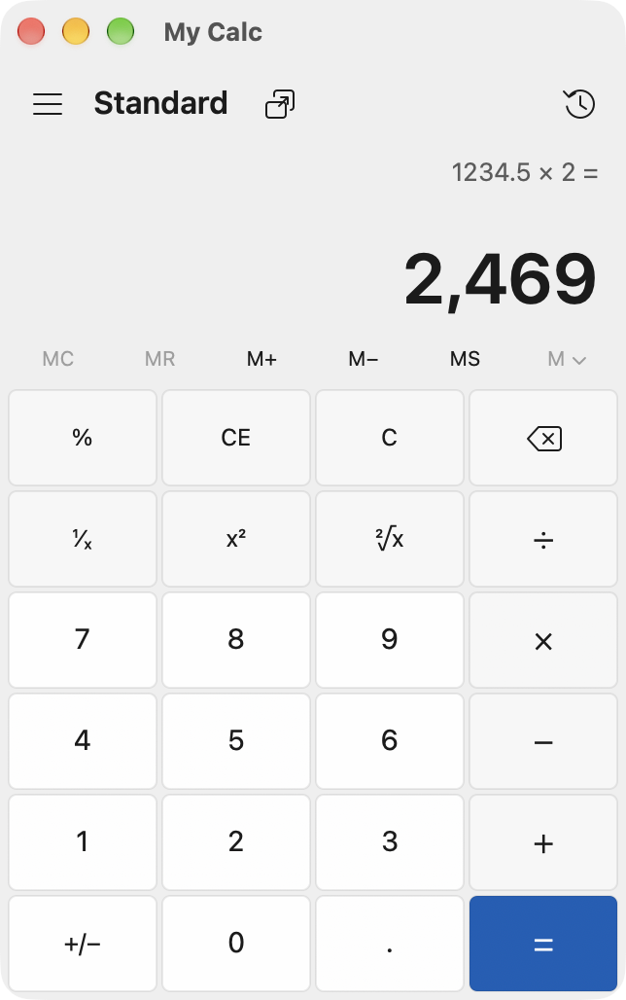

# My Calc

[Português (Brasil)](../../README.md) · **English** · [Español](es.md) · [Français](fr.md) · [Deutsch](de.md) · [Italiano](it.md) · [日本語](ja.md) · [한국어](ko.md)

**My suite:** [My Explorer](https://github.com/leoars/my-explorer/blob/main/README.md) · [My Notepad](https://github.com/leoars/My-Notepad/blob/main/docs/readme/en.md) · [My Paint](https://github.com/leoars/my-paint/blob/main/docs/readme/en.md) · **My Calc**

A simple calculator for macOS. Do the math in Standard, Scientific or Programmer mode, with the keys and shortcuts your hands already know.

## Download for macOS

- **[Download for Apple Silicon (M-series)](https://github.com/leoars/my-calc/releases/download/1.0/My-Calc-1.0-arm64.pkg)**
- **[Download for Intel](https://github.com/leoars/my-calc/releases/download/1.0/My-Calc-1.0-x86_64.pkg)**

Requires macOS 12 or later. [View the latest release](https://github.com/leoars/my-calc/releases/latest)

To install My Explorer, My Notepad, My Paint and My Calc in one go, use the [My suite installer](https://github.com/leoars/my-suite/blob/main/docs/readme/en.md).



## Why My Calc?

My Calc was born from the same idea as My Notepad and My Paint: a calculator that fits in a corner of the screen, with the display at the top, the memory in the middle and the keys at the bottom, and that answers to the computer keyboard without making you hunt for anything. The project delivers that way of working in Swift and AppKit, with no external dependencies. The arithmetic is its own and decimal, so 0.1 + 0.2 is 0.3. Keys, display and icon were drawn from scratch.

## Features

### Standard

- The four operations, **%**, **¹⁄ₓ**, **x²**, **²√x** and **+/−**, in the order the keys are pressed: `1 + 2 × 3 =` gives 9.
- **=** again repeats the last operation; an operator right after another replaces it.
- **⌫** deletes the last digit, **CE** clears the number and **C** clears the calculation.
- The calculation in progress appears on a line above the number, and stays there with the result.

### Scientific

- Follows operator precedence and parentheses: `1 + 2 × 3 =` gives 7.
- **Trigonometry**: sin, cos, tan, sec, csc and cot, their inverses and the hyperbolic functions, in degrees, radians or grads (**DEG**, **RAD**, **GRAD**).
- **x²**, **²√x**, **xʸ**, **10ˣ**, **log** and **ln**; with **2ⁿᵈ**, **x³**, **³√x**, **ʸ√x**, **2ˣ**, **logᵧx** and **eˣ**.
- **n!**, for non-integer numbers too, **|x|**, **π**, **e**, **mod**, and **exp** to enter the power of ten.
- **Function**: ⌊x⌋, ⌈x⌉, rand and the conversion between decimal degrees and degrees, minutes and seconds.
- **F-E** shows the result in scientific notation.


### Programmer

- The number is shown in **HEX**, **DEC**, **OCT** and **BIN** at the same time; a click on one of the lines chooses the base you type in.
- 64-, 32-, 16- or 8-bit words (**QWORD**, **DWORD**, **WORD**, **BYTE**) in two's complement.
- **<<**, **>>** and the **Bitwise** menu (AND, OR, NOT, NAND, NOR, XOR, RoL and RoR), with precedence and parentheses.
- A panel with the 64 bits of the number in place of the keys; a click on a bit flips it.


### Memory and history

- **MS** stores the number in a list; **MR** recalls the most recent one, **M+** and **M−** add to it and subtract from it, and **MC** empties the list. **M** opens the list over the keys: a click on a number brings it back.
- The clock button (`Ctrl+H`) opens the history of the calculations made in Standard and Scientific modes, each with its result; a click on a line brings the result back and the trash can clears the list.
- **Copy** takes the number on the display. **Paste** types whatever is on the clipboard, be it a number, with a period or a comma, or a whole calculation such as `2+3*4=`.

### Numbers

- Decimal arithmetic with 32 significant digits on the display: no 0.30000000000000004.
- Numbers up to 10 to the power of 10000; what does not fit in 32 digits is shown in scientific notation.
- What is exact comes out exact: the sine of 30° is 0.5, the logarithm of 1000 is 3 and the square root of 2, squared, is 2.
- Grouped digits and a decimal separator with the signs of your region; grouping can be turned off.
- Errors say what happened: division by zero, undefined result, invalid input and overflow.

### Interface and languages

- The three-line button switches modes and leads to **Settings…**; the same commands are in the macOS menu bar.
- Light or dark appearance, following the system, and a resizable window: the keys grow with it.
- **Keep on Top** keeps the calculator above the other windows.
- The mode, the angle unit, digit grouping and the window position are remembered.
- Available in Portuguese, English, Spanish, French, German, Italian, Japanese and Korean.
- **Check for Updates…** in the My Calc menu, and a check when the app opens, at most once a day, which you can turn off in **Settings…**. A new version is downloaded only when you agree, is checked (the developer's signature and Apple's notarization) and opens in the macOS Installer; My Calc opens again when the Installer closes.

### Keyboard shortcuts

The numeric keypad and the usual keys work; the menu commands use `Cmd`.

| Keys | Action |
| --- | --- |
| `0`–`9` · `,` or `.` · `+` `-` `*` `/` | Digits, decimal separator and operations |
| `Enter` or `=` · `Backspace` · `Delete` · `Esc` | Equals, delete a digit, CE and C |
| `F9` · `R` · `Q` · `@` · `%` | Change the sign, ¹⁄ₓ, x², ²√x and percent |
| `Ctrl+L` · `Ctrl+R` · `Ctrl+M` · `Ctrl+P` · `Ctrl+Q` | MC, MR, MS, M+ and M− |
| `Option+1` to `Option+3` (or `Cmd+1` to `Cmd+3`) | Standard, Scientific and Programmer |
| `Ctrl+H` (or `Cmd+Y`) · `Ctrl+Shift+D` | Open the history and clear it |
| `Cmd+C` · `Cmd+V` · `Cmd+T` | Copy, paste and keep on top |
| `S` · `O` · `T` · `U` · `I` · `J` | sin, cos, tan, sec, csc and cot; with `Shift`, their inverses |
| `Ctrl+S` · `Ctrl+O` · `Ctrl+T` | sinh, cosh and tanh |
| `N` · `Ctrl+N` · `L` · `Ctrl+G` | ln, eˣ, log and 10ˣ |
| `#` · `Y` · `Ctrl+B` · `Ctrl+Y` · `!` | x³, xʸ, ³√x, ʸ√x and n! |
| `P` · `E` · `X` · `D` · `M` · `V` · `(` `)` | π, e, exp, mod, degrees-minutes-seconds, F-E and parentheses |
| `\|` · `[` · `]` | \|x\|, ⌊x⌋ and ⌈x⌉ |
| `F3` · `F4` · `F5` | DEG, RAD and GRAD (Scientific) |
| `F5` · `F6` · `F7` · `F8` | HEX, DEC, OCT and BIN (Programmer) |
| `F12` · `F2` · `F3` · `F4` | QWORD, DWORD, WORD and BYTE (Programmer) |
| `&` · `\|` · `^` · `~` · `.` · `,` | AND, OR, XOR, NOT, NAND and NOR (Programmer) |
| `<` · `>` · `J` · `K` · `%` | <<, >>, RoL, RoR and remainder of the division (Programmer) |

## Part of the My suite

My Calc is part of the My suite: simple, straightforward apps for macOS, with the menus and shortcuts you already know.

- **My Calc** (this repository): a simple calculator.
- **[My Explorer](https://github.com/leoars/my-explorer/blob/main/README.md)**: a file manager with a folder tree, tabs and a command bar.
- **[My Notepad](https://github.com/leoars/My-Notepad/blob/main/docs/readme/en.md)**: a simple text editor.
- **[My Paint](https://github.com/leoars/my-paint/blob/main/docs/readme/en.md)**: a simple image editor.
- **[My Suite](https://github.com/leoars/my-suite/blob/main/docs/readme/en.md)**: the installer that brings the four apps together, letting you choose which ones to install.

## Build and install on Mac

The installers target macOS 12 or later, on Apple Silicon and Intel. To build on your Mac, you need Apple’s developer tools with the Swift compiler. From the project root, run:

```sh
./build.sh
open "My Calc.app"
```

To run the automated tests:

```sh
./test.sh
```

To build both installers, run the command below. In `dist/`, choose the `arm64` package for Apple Silicon or `x86_64` for Intel. Open the `.pkg` to install the app in `/Applications`.

```sh
./package.sh
```

The icon is drawn in code by `Tools/icon.swift`; to regenerate it, run `swift Tools/icon.swift Resources/MyCalc.icns`.

## Contributing

The calculation engine lives in [Sources](../../Sources), separate from the interface: `BigDecimal.swift` (the decimal number), `BigMath.swift` (the functions) and `Calculator.swift` (the keys). The tests are in [Tests](../../Tests) and the [translations](../../Resources) live in one `.lproj` directory per language. When reporting a wrong result, include your macOS version, the mode, the key sequence and what the display showed.

## License

Original code and documentation are distributed under the [Apache License 2.0](../../LICENSE). See [THIRD_PARTY_NOTICES.md](../../THIRD_PARTY_NOTICES.md).
