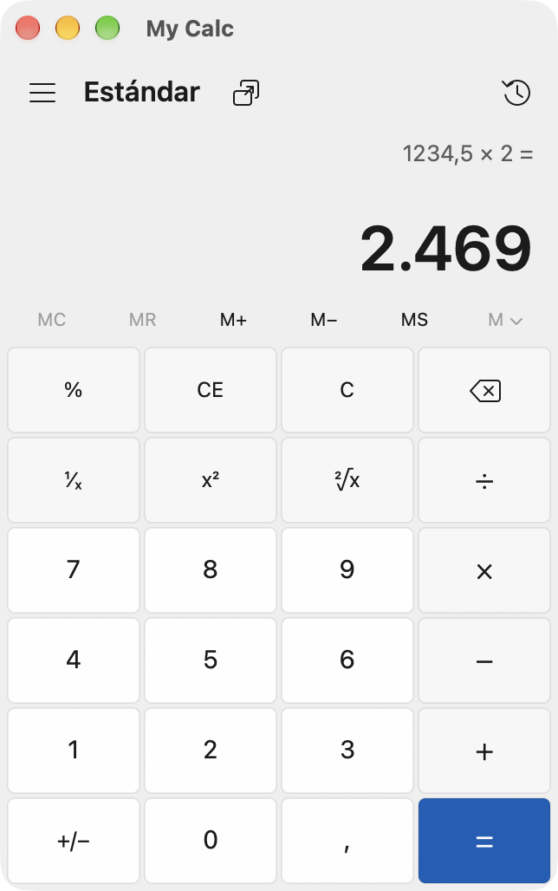

# My Calc

[Português (Brasil)](../../README.md) · [English](en.md) · **Español** · [Français](fr.md) · [Deutsch](de.md) · [Italiano](it.md) · [日本語](ja.md) · [한국어](ko.md)

**Suite My:** [My Explorer](https://github.com/leoars/my-explorer/blob/main/README.es.md) · [My Notepad](https://github.com/leoars/My-Notepad/blob/main/docs/readme/es.md) · [My Paint](https://github.com/leoars/my-paint/blob/main/docs/readme/es.md) · **My Calc**

Una calculadora sencilla para macOS. Haz la cuenta en el modo estándar, científico o de programador, con las teclas y los atajos que ya conoces.

## Descargar para macOS

- **[Descargar para Apple Silicon (serie M)](https://github.com/leoars/my-calc/releases/download/1.0/My-Calc-1.0-arm64.pkg)**
- **[Descargar para Intel](https://github.com/leoars/my-calc/releases/download/1.0/My-Calc-1.0-x86_64.pkg)**

Requiere macOS 12 o posterior. [Ver la última versión](https://github.com/leoars/my-calc/releases/latest)

Para instalar My Explorer, My Notepad, My Paint y My Calc de una vez, usa el [instalador de la suite My](https://github.com/leoars/my-suite/blob/main/docs/readme/es.md).



## ¿Por qué existe este proyecto?

My Calc nace de la misma idea que My Notepad y My Paint: una calculadora que cabe en un rincón del escritorio, con la pantalla arriba, la memoria en medio y las teclas abajo, y que responde al teclado del ordenador sin que haya que buscar nada. El proyecto ofrece esa forma de trabajar en Swift y AppKit, sin dependencias externas. La aritmética es propia y decimal, así que 0,1 + 0,2 da 0,3. Las teclas, la pantalla y el icono se dibujaron desde cero.

## Funciones

### Estándar

- Las cuatro operaciones, **%**, **¹⁄ₓ**, **x²**, **²√x** y **+/−**, en el orden en que se pulsan las teclas: `1 + 2 × 3 =` da 9.
- **=** otra vez repite la última operación; un operador justo después de otro lo sustituye.
- **⌫** borra el último dígito, **CE** borra el número y **C** borra la cuenta.
- La cuenta en curso aparece en una línea encima del número, y se queda ahí con el resultado.

### Científica

- Respeta la precedencia de los operadores y los paréntesis: `1 + 2 × 3 =` da 7.
- **Trigonometría**: sin, cos, tan, sec, csc y cot, las inversas y las hiperbólicas, en grados, radianes o gradianes (**DEG**, **RAD**, **GRAD**).
- **x²**, **²√x**, **xʸ**, **10ˣ**, **log** y **ln**; con **2ⁿᵈ**, **x³**, **³√x**, **ʸ√x**, **2ˣ**, **logᵧx** y **eˣ**.
- **n!**, también para números no enteros, **|x|**, **π**, **e**, **mod** y **exp** para introducir el exponente de diez.
- **Función**: ⌊x⌋, ⌈x⌉, rand y la conversión entre grados decimales y grados, minutos y segundos.
- **F-E** muestra el resultado en notación científica.


### Programador

- El número aparece a la vez en **HEX**, **DEC**, **OCT** y **BIN**; un clic en una de las líneas elige la base en la que se escribe.
- Palabras de 64, 32, 16 u 8 bits (**QWORD**, **DWORD**, **WORD**, **BYTE**) en complemento a dos.
- **<<**, **>>** y el menú **Bit a bit** (AND, OR, NOT, NAND, NOR, XOR, RoL y RoR), con precedencia y paréntesis.
- Panel con los 64 bits del número en lugar de las teclas; un clic en un bit lo invierte.


### Memoria e historial

- **MS** guarda el número en una lista; **MR** recupera el más reciente, **M+** y **M−** le suman y le restan y **MC** vacía la lista. **M** abre la lista sobre las teclas: un clic en un número lo recupera.
- El botón del reloj (`Ctrl+H`) abre el historial de las cuentas de los modos estándar y científico, con el resultado de cada una; un clic en una línea recupera el resultado y la papelera borra la lista.
- **Copiar** se lleva el número de la pantalla. **Pegar** escribe lo que haya en el portapapeles, ya sea un número, con punto o con coma, o una cuenta entera como `2+3*4=`.

### Números

- Aritmética decimal con 32 dígitos significativos en la pantalla: nada de 0,30000000000000004.
- Números hasta 10 elevado a 10000; lo que no cabe en 32 dígitos aparece en notación científica.
- Lo que es exacto sale exacto: el seno de 30° es 0,5, el logaritmo de 1000 es 3 y la raíz de 2 al cuadrado es 2.
- Dígitos agrupados y separador decimal con los signos de tu región; la agrupación se puede desactivar.
- Los errores dicen qué ha pasado: división entre cero, resultado indefinido, entrada no válida y desbordamiento.

### Interfaz e idiomas

- El botón de tres líneas cambia de modo y lleva a **Ajustes…**; los mismos comandos están en la barra de menús de macOS.
- Aspecto claro u oscuro, según el sistema, y ventana redimensionable: las teclas crecen con ella.
- **Mantener visible** deja la calculadora por encima de las demás ventanas.
- Se recuerdan el modo, la unidad de ángulo, la agrupación de dígitos y la posición de la ventana.
- Disponible en portugués, inglés, español, francés, alemán, italiano, japonés y coreano.
- **Buscar actualizaciones…** en el menú My Calc, y una comprobación al abrir, como máximo una vez al día, que puedes desactivar en **Ajustes…**. La versión nueva solo se descarga si la aceptas, se verifica (firma del desarrollador y notarización de Apple) y se abre en el Instalador de macOS; My Calc se vuelve a abrir cuando se cierra el Instalador.

### Atajos

El teclado numérico y las teclas de siempre funcionan; los comandos de menú usan `Cmd`.

| Teclas | Acción |
| --- | --- |
| `0`–`9` · `,` o `.` · `+` `-` `*` `/` | Dígitos, separador decimal y operaciones |
| `Enter` o `=` · `Backspace` · `Delete` · `Esc` | Igual, borrar un dígito, CE y C |
| `F9` · `R` · `Q` · `@` · `%` | Cambiar el signo, ¹⁄ₓ, x², ²√x y porcentaje |
| `Ctrl+L` · `Ctrl+R` · `Ctrl+M` · `Ctrl+P` · `Ctrl+Q` | MC, MR, MS, M+ y M− |
| `Option+1` a `Option+3` (o `Cmd+1` a `Cmd+3`) | Estándar, científica y programador |
| `Ctrl+H` (o `Cmd+Y`) · `Ctrl+Shift+D` | Abrir el historial y borrarlo |
| `Cmd+C` · `Cmd+V` · `Cmd+T` | Copiar, pegar y mantener visible |
| `S` · `O` · `T` · `U` · `I` · `J` | sin, cos, tan, sec, csc y cot; con `Shift`, las inversas |
| `Ctrl+S` · `Ctrl+O` · `Ctrl+T` | sinh, cosh y tanh |
| `N` · `Ctrl+N` · `L` · `Ctrl+G` | ln, eˣ, log y 10ˣ |
| `#` · `Y` · `Ctrl+B` · `Ctrl+Y` · `!` | x³, xʸ, ³√x, ʸ√x y n! |
| `P` · `E` · `X` · `D` · `M` · `V` · `(` `)` | π, e, exp, mod, grados-minutos-segundos, F-E y paréntesis |
| `\|` · `[` · `]` | \|x\|, ⌊x⌋ y ⌈x⌉ |
| `F3` · `F4` · `F5` | DEG, RAD y GRAD (científica) |
| `F5` · `F6` · `F7` · `F8` | HEX, DEC, OCT y BIN (programador) |
| `F12` · `F2` · `F3` · `F4` | QWORD, DWORD, WORD y BYTE (programador) |
| `&` · `\|` · `^` · `~` · `.` · `,` | AND, OR, XOR, NOT, NAND y NOR (programador) |
| `<` · `>` · `J` · `K` · `%` | <<, >>, RoL, RoR y resto de la división (programador) |

## Parte de la suite My

My Calc forma parte de la suite My: aplicaciones para macOS sencillas y directas, con los menús y los atajos de siempre.

- **My Calc** (este repositorio): calculadora sencilla.
- **[My Explorer](https://github.com/leoars/my-explorer/blob/main/README.es.md)**: gestor de archivos con árbol de carpetas, pestañas y barra de comandos.
- **[My Notepad](https://github.com/leoars/My-Notepad/blob/main/docs/readme/es.md)**: editor de texto sencillo.
- **[My Paint](https://github.com/leoars/my-paint/blob/main/docs/readme/es.md)**: editor de imágenes sencillo.
- **[My Suite](https://github.com/leoars/my-suite/blob/main/docs/readme/es.md)**: el instalador que reúne las cuatro aplicaciones, con la opción de elegir cuáles instalar.

## Compilar e instalar en el Mac

Los instaladores están pensados para macOS 12 o posterior, en Apple Silicon e Intel. Para compilar, usa las herramientas de desarrollo de Apple con el compilador de Swift. En la raíz del proyecto, ejecuta:

```sh
./build.sh
open "My Calc.app"
```

Para ejecutar las pruebas automáticas:

```sh
./test.sh
```

Para generar los dos instaladores, ejecuta el comando siguiente. En `dist/`, elige el paquete `arm64` para Apple Silicon o `x86_64` para Intel. Abre el archivo `.pkg` para instalar la aplicación en `/Applications`.

```sh
./package.sh
```

El icono se dibuja por código en `Tools/icon.swift`; para generarlo de nuevo, ejecuta `swift Tools/icon.swift Resources/MyCalc.icns`.

## Cómo contribuir

El motor de cálculo está en [Sources](../../Sources), separado de la interfaz: `BigDecimal.swift` (el número decimal), `BigMath.swift` (las funciones) y `Calculator.swift` (las teclas). Las pruebas están en [Tests](../../Tests) y las [traducciones](../../Resources) en carpetas `.lproj`, una por idioma. Al informar de un resultado incorrecto, incluye la versión de macOS, el modo, la secuencia de teclas y lo que apareció en la pantalla.

## Licencia

El código y la documentación originales se distribuyen bajo la [Apache License 2.0](../../LICENSE). Consulta [THIRD_PARTY_NOTICES.md](../../THIRD_PARTY_NOTICES.md).
