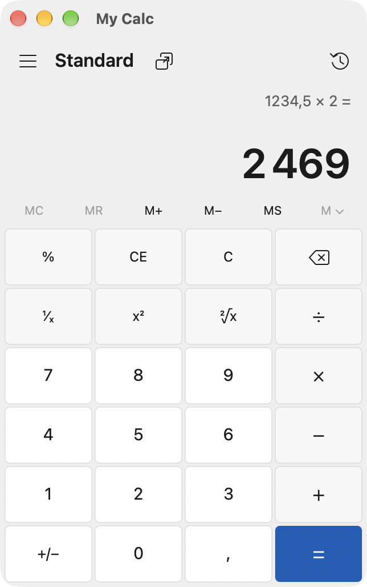
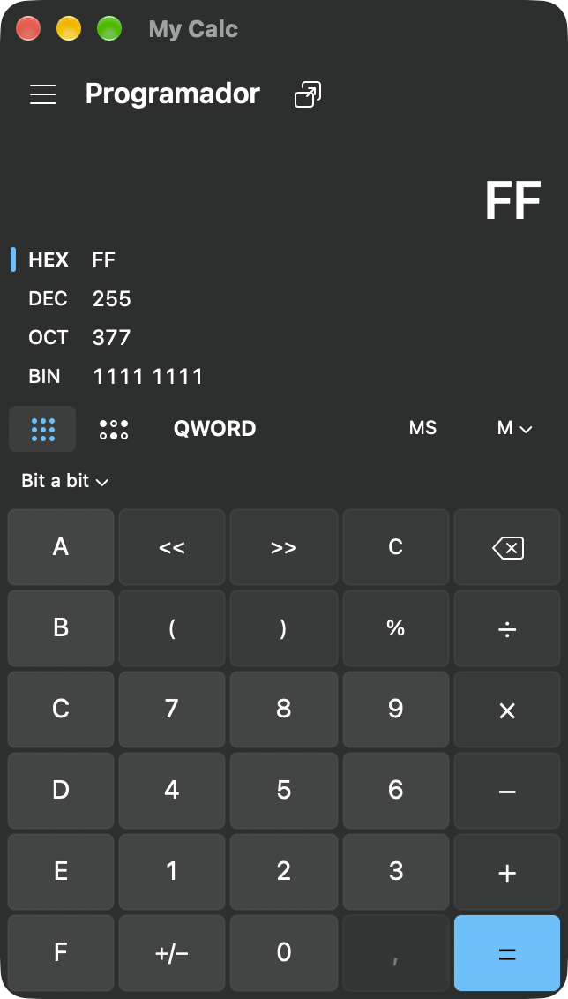

# My Calc

[Português (Brasil)](../../README.md) · [English](en.md) · [Español](es.md) · **Français** · [Deutsch](de.md) · [Italiano](it.md) · [日本語](ja.md) · [한국어](ko.md)

**Suite My:** [My Explorer](https://github.com/leoars/my-explorer/blob/main/README.fr.md) · [My Notepad](https://github.com/leoars/My-Notepad/blob/main/docs/readme/fr.md) · [My Paint](https://github.com/leoars/my-paint/blob/main/docs/readme/fr.md) · **My Calc**

Une calculatrice simple pour macOS. Faites vos calculs en mode standard, scientifique ou programmeur, avec les touches et les raccourcis que vous connaissez déjà.

## Télécharger pour macOS

- **[Télécharger pour Apple Silicon (série M)](https://github.com/leoars/my-calc/releases/download/1.0/My-Calc-1.0-arm64.pkg)**
- **[Télécharger pour Intel](https://github.com/leoars/my-calc/releases/download/1.0/My-Calc-1.0-x86_64.pkg)**

Nécessite macOS 12 ou une version ultérieure. [Voir la dernière version](https://github.com/leoars/my-calc/releases/latest)

Pour installer My Explorer, My Notepad, My Paint et My Calc en une seule fois, utilisez le [programme d’installation de la suite My](https://github.com/leoars/my-suite/blob/main/docs/readme/fr.md).



## Pourquoi ce projet ?

My Calc est né de la même idée que My Notepad et My Paint : une calculatrice qui tient dans un coin de l’écran, avec l’afficheur en haut, la mémoire au milieu et les touches en bas, et qui répond au clavier de l’ordinateur sans qu’il faille chercher quoi que ce soit. Le projet propose cette façon de travailler en Swift et AppKit, sans dépendance externe. L’arithmétique est maison et décimale, si bien que 0,1 + 0,2 donne 0,3. Les touches, l’afficheur et l’icône ont été dessinés de zéro.

## Fonctionnalités

### Standard

- Les quatre opérations, **%**, **¹⁄ₓ**, **x²**, **²√x** et **+/−**, dans l’ordre où les touches sont pressées : `1 + 2 × 3 =` donne 9.
- **=** une nouvelle fois répète la dernière opération ; un opérateur saisi juste après un autre le remplace.
- **⌫** efface le dernier chiffre, **CE** efface le nombre et **C** efface le calcul.
- Le calcul en cours apparaît sur une ligne au-dessus du nombre, et y reste avec le résultat.

### Scientifique

- Respecte la priorité des opérateurs et les parenthèses : `1 + 2 × 3 =` donne 7.
- **Trigonométrie** : sin, cos, tan, sec, csc et cot, leurs inverses et les fonctions hyperboliques, en degrés, radians ou grades (**DEG**, **RAD**, **GRAD**).
- **x²**, **²√x**, **xʸ**, **10ˣ**, **log** et **ln** ; avec **2ⁿᵈ**, **x³**, **³√x**, **ʸ√x**, **2ˣ**, **logᵧx** et **eˣ**.
- **n!**, y compris pour les nombres non entiers, **|x|**, **π**, **e**, **mod** et **exp** pour saisir l’exposant de dix.
- **Fonction** : ⌊x⌋, ⌈x⌉, rand et la conversion entre degrés décimaux et degrés, minutes et secondes.
- **F-E** affiche le résultat en notation scientifique.


### Programmeur

- Le nombre s’affiche en même temps en **HEX**, **DEC**, **OCT** et **BIN** ; un clic sur l’une des lignes choisit la base de saisie.
- Mots de 64, 32, 16 ou 8 bits (**QWORD**, **DWORD**, **WORD**, **BYTE**) en complément à deux.
- **<<**, **>>** et le menu **Au niveau du bit** (AND, OR, NOT, NAND, NOR, XOR, RoL et RoR), avec priorité et parenthèses.
- Panneau avec les 64 bits du nombre à la place des touches ; un clic sur un bit l’inverse.



### Mémoire et historique

- **MS** range le nombre dans une liste ; **MR** rappelle le plus récent, **M+** et **M−** lui ajoutent et lui retranchent le nombre affiché et **MC** vide la liste. **M** ouvre la liste par-dessus les touches : un clic sur un nombre le rappelle.
- Le bouton à l’horloge (`Ctrl+H`) ouvre l’historique des calculs des modes standard et scientifique, avec le résultat de chacun ; un clic sur une ligne rappelle le résultat et la corbeille efface la liste.
- **Copier** prend le nombre affiché. **Coller** saisit le contenu du presse-papiers, qu’il s’agisse d’un nombre, avec un point ou une virgule, ou d’un calcul entier comme `2+3*4=`.

### Nombres

- Arithmétique décimale avec 32 chiffres significatifs sur l’afficheur : pas de 0,30000000000000004.
- Nombres jusqu’à 10 puissance 10000 ; ce qui ne tient pas en 32 chiffres s’affiche en notation scientifique.
- Ce qui est exact sort exact : le sinus de 30° vaut 0,5, le logarithme de 1000 vaut 3 et la racine de 2 au carré vaut 2.
- Chiffres groupés et séparateur décimal avec les signes de votre région ; le groupement peut être désactivé.
- Les erreurs disent ce qui s’est passé : division par zéro, résultat non défini, entrée non valide et dépassement de capacité.

### Interface et langues

- Le bouton à trois lignes change de mode et mène aux **Réglages…** ; les mêmes commandes se trouvent dans la barre des menus de macOS.
- Apparence claire ou sombre, selon le système, et fenêtre redimensionnable : les touches grandissent avec elle.
- **Toujours visible** garde la calculatrice au-dessus des autres fenêtres.
- Le mode, l’unité d’angle, le groupement des chiffres et la position de la fenêtre sont mémorisés.
- Disponible en portugais, anglais, espagnol, français, allemand, italien, japonais et coréen.
- **Rechercher les mises à jour…** dans le menu My Calc, et une vérification à l’ouverture, au plus une fois par jour, que vous pouvez désactiver dans **Réglages…**. La nouvelle version n’est téléchargée qu’avec votre accord, elle est vérifiée (signature du développeur et notarisation d’Apple) et s’ouvre dans le programme d’installation de macOS ; My Calc se rouvre à la fin de l’installation.

### Raccourcis

Le pavé numérique et les touches habituelles fonctionnent ; les commandes de menu utilisent `Cmd`.

| Touches | Action |
| --- | --- |
| `0`–`9` · `,` ou `.` · `+` `-` `*` `/` | Chiffres, séparateur décimal et opérations |
| `Enter` ou `=` · `Backspace` · `Delete` · `Esc` | Égal, effacer un chiffre, CE et C |
| `F9` · `R` · `Q` · `@` · `%` | Changer le signe, ¹⁄ₓ, x², ²√x et pourcentage |
| `Ctrl+L` · `Ctrl+R` · `Ctrl+M` · `Ctrl+P` · `Ctrl+Q` | MC, MR, MS, M+ et M− |
| `Option+1` à `Option+3` (ou `Cmd+1` à `Cmd+3`) | Standard, scientifique et programmeur |
| `Ctrl+H` (ou `Cmd+Y`) · `Ctrl+Shift+D` | Ouvrir l’historique et l’effacer |
| `Cmd+C` · `Cmd+V` · `Cmd+T` | Copier, coller et toujours visible |
| `S` · `O` · `T` · `U` · `I` · `J` | sin, cos, tan, sec, csc et cot ; avec `Shift`, leurs inverses |
| `Ctrl+S` · `Ctrl+O` · `Ctrl+T` | sinh, cosh et tanh |
| `N` · `Ctrl+N` · `L` · `Ctrl+G` | ln, eˣ, log et 10ˣ |
| `#` · `Y` · `Ctrl+B` · `Ctrl+Y` · `!` | x³, xʸ, ³√x, ʸ√x et n! |
| `P` · `E` · `X` · `D` · `M` · `V` · `(` `)` | π, e, exp, mod, degrés-minutes-secondes, F-E et parenthèses |
| `\|` · `[` · `]` | \|x\|, ⌊x⌋ et ⌈x⌉ |
| `F3` · `F4` · `F5` | DEG, RAD et GRAD (scientifique) |
| `F5` · `F6` · `F7` · `F8` | HEX, DEC, OCT et BIN (programmeur) |
| `F12` · `F2` · `F3` · `F4` | QWORD, DWORD, WORD et BYTE (programmeur) |
| `&` · `\|` · `^` · `~` · `.` · `,` | AND, OR, XOR, NOT, NAND et NOR (programmeur) |
| `<` · `>` · `J` · `K` · `%` | <<, >>, RoL, RoR et reste de la division (programmeur) |

## Un élément de la suite My

My Calc fait partie de la suite My : des applications pour macOS simples et directes, avec les menus et les raccourcis de toujours.

- **My Calc** (ce dépôt) : calculatrice simple.
- **[My Explorer](https://github.com/leoars/my-explorer/blob/main/README.fr.md)** : gestionnaire de fichiers avec arborescence des dossiers, onglets et barre de commandes.
- **[My Notepad](https://github.com/leoars/My-Notepad/blob/main/docs/readme/fr.md)** : éditeur de texte simple.
- **[My Paint](https://github.com/leoars/my-paint/blob/main/docs/readme/fr.md)** : éditeur d’images simple.
- **[My Suite](https://github.com/leoars/my-suite/blob/main/docs/readme/fr.md)** : le programme d’installation qui réunit les quatre applications, avec le choix de celles à installer.

## Compiler et installer sur Mac

Les programmes d’installation ciblent macOS 12 ou une version ultérieure, sur Apple Silicon et Intel. Pour compiler, utilisez les outils de développement d’Apple avec le compilateur Swift. À la racine du projet, exécutez :

```sh
./build.sh
open "My Calc.app"
```

Pour lancer les tests automatiques :

```sh
./test.sh
```

Pour générer les deux programmes d’installation, exécutez la commande ci-dessous. Dans `dist/`, choisissez le paquet `arm64` pour Apple Silicon ou `x86_64` pour Intel. Ouvrez le fichier `.pkg` pour installer l’application dans `/Applications`.

```sh
./package.sh
```

L’icône est dessinée par le code de `Tools/icon.swift` ; pour la régénérer, exécutez `swift Tools/icon.swift Resources/MyCalc.icns`.

## Contribuer

Le moteur de calcul se trouve dans [Sources](../../Sources), séparé de l’interface : `BigDecimal.swift` (le nombre décimal), `BigMath.swift` (les fonctions) et `Calculator.swift` (les touches). Les tests se trouvent dans [Tests](../../Tests) et les [traductions](../../Resources) sont réparties dans des dossiers `.lproj`, un par langue. Pour signaler un résultat erroné, indiquez la version de macOS, le mode, la séquence de touches et ce qui s’est affiché.

## Licence

Le code et la documentation d’origine sont distribués sous la [licence Apache 2.0](../../LICENSE). Voir [THIRD_PARTY_NOTICES.md](../../THIRD_PARTY_NOTICES.md).
