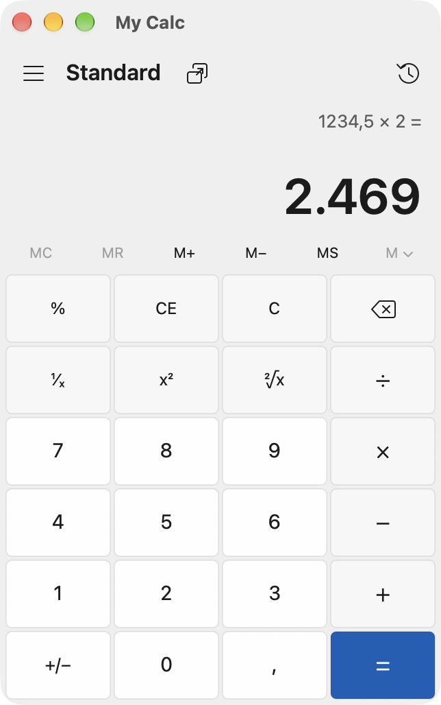

# My Calc

[Português (Brasil)](../../README.md) · [English](en.md) · [Español](es.md) · [Français](fr.md) · [Deutsch](de.md) · **Italiano** · [日本語](ja.md) · [한국어](ko.md)

**Suite My:** [My Explorer](https://github.com/leoars/my-explorer/blob/main/README.it.md) · [My Notepad](https://github.com/leoars/My-Notepad/blob/main/docs/readme/it.md) · [My Paint](https://github.com/leoars/my-paint/blob/main/docs/readme/it.md) · **My Calc**

Una semplice calcolatrice per macOS. Fai i conti in modalità standard, scientifica o programmatore, con i tasti e le scorciatoie che conosci già.

## Scarica per macOS

- **[Scarica per Apple Silicon (serie M)](https://github.com/leoars/my-calc/releases/download/1.0/My-Calc-1.0-arm64.pkg)**
- **[Scarica per Intel](https://github.com/leoars/my-calc/releases/download/1.0/My-Calc-1.0-x86_64.pkg)**

Richiede macOS 12 o successivo. [Vedi la versione più recente](https://github.com/leoars/my-calc/releases/latest)

Per installare My Explorer, My Notepad, My Paint e My Calc in una volta sola, usa il [programma di installazione della suite My](https://github.com/leoars/my-suite/blob/main/docs/readme/it.md).



## Perché esiste questo progetto?

My Calc nasce dalla stessa idea di My Notepad e My Paint: una calcolatrice che sta in un angolo dello schermo, con il display in alto, la memoria al centro e i tasti in basso, e che risponde alla tastiera del computer senza che ci sia bisogno di cercare nulla. Il progetto offre quel modo di lavorare in Swift e AppKit, senza dipendenze esterne. L’aritmetica è propria e decimale, quindi 0,1 + 0,2 fa 0,3. Tasti, display e icona sono stati disegnati da zero.

## Funzionalità

### Standard

- Le quattro operazioni, **%**, **¹⁄ₓ**, **x²**, **²√x** e **+/−**, nell’ordine in cui vengono premuti i tasti: `1 + 2 × 3 =` fa 9.
- **=** di nuovo ripete l’ultima operazione; un operatore subito dopo un altro lo sostituisce.
- **⌫** cancella l’ultima cifra, **CE** cancella il numero e **C** cancella il calcolo.
- Il calcolo in corso appare in una riga sopra il numero, e resta lì con il risultato.

### Scientifica

- Rispetta la precedenza degli operatori e le parentesi: `1 + 2 × 3 =` fa 7.
- **Trigonometria**: sin, cos, tan, sec, csc e cot, le inverse e le iperboliche, in gradi, radianti o gradienti (**DEG**, **RAD**, **GRAD**).
- **x²**, **²√x**, **xʸ**, **10ˣ**, **log** e **ln**; con **2ⁿᵈ**, **x³**, **³√x**, **ʸ√x**, **2ˣ**, **logᵧx** ed **eˣ**.
- **n!**, anche per i numeri non interi, **|x|**, **π**, **e**, **mod** ed **exp** per inserire l’esponente di dieci.
- **Funzione**: ⌊x⌋, ⌈x⌉, rand e la conversione tra gradi decimali e gradi, minuti e secondi.
- **F-E** mostra il risultato in notazione scientifica.


### Programmatore

- Il numero appare contemporaneamente in **HEX**, **DEC**, **OCT** e **BIN**; un clic su una delle righe sceglie la base di immissione.
- Parole di 64, 32, 16 o 8 bit (**QWORD**, **DWORD**, **WORD**, **BYTE**) in complemento a due.
- **<<**, **>>** e il menu **Bit per bit** (AND, OR, NOT, NAND, NOR, XOR, RoL e RoR), con precedenza e parentesi.
- Pannello con i 64 bit del numero al posto dei tasti; un clic su un bit lo inverte.


### Memoria e cronologia

- **MS** salva il numero in un elenco; **MR** richiama il più recente, **M+** e **M−** gli sommano e gli sottraggono il numero sul display e **MC** svuota l’elenco. **M** apre l’elenco sopra i tasti: un clic su un numero lo richiama.
- Il pulsante con l’orologio (`Ctrl+H`) apre la cronologia dei calcoli delle modalità standard e scientifica, ciascuno con il suo risultato; un clic su una riga richiama il risultato e il cestino cancella l’elenco.
- **Copia** prende il numero sul display. **Incolla** digita ciò che si trova negli appunti, che sia un numero, con il punto o la virgola, o un calcolo intero come `2+3*4=`.

### Numeri

- Aritmetica decimale con 32 cifre significative sul display: niente 0,30000000000000004.
- Numeri fino a 10 elevato a 10000; ciò che non sta in 32 cifre appare in notazione scientifica.
- Ciò che è esatto esce esatto: il seno di 30° è 0,5, il logaritmo di 1000 è 3 e la radice di 2 al quadrato è 2.
- Cifre raggruppate e separatore decimale con i segni della tua regione; il raggruppamento si può disattivare.
- Gli errori dicono che cosa è successo: divisione per zero, risultato non definito, valore non valido e overflow.

### Interfaccia e lingue

- Il pulsante con le tre linee cambia modalità e porta a **Impostazioni…**; gli stessi comandi sono nella barra dei menu di macOS.
- Aspetto chiaro o scuro, in base al sistema, e finestra ridimensionabile: i tasti crescono con lei.
- **Mantieni in primo piano** tiene la calcolatrice sopra le altre finestre.
- La modalità, l’unità angolare, il raggruppamento delle cifre e la posizione della finestra vengono ricordati.
- Disponibile in portoghese, inglese, spagnolo, francese, tedesco, italiano, giapponese e coreano.
- **Verifica aggiornamenti…** nel menu My Calc, e un controllo all’apertura, al massimo una volta al giorno, che puoi disattivare in **Impostazioni…**. La nuova versione viene scaricata solo con il tuo consenso, verificata (firma dello sviluppatore e notarizzazione di Apple) e aperta nel programma di installazione di macOS; My Calc si riapre al termine.

### Scorciatoie

Il tastierino numerico e i tasti di sempre funzionano; i comandi di menu usano `Cmd`.

| Tasti | Azione |
| --- | --- |
| `0`–`9` · `,` o `.` · `+` `-` `*` `/` | Cifre, separatore decimale e operazioni |
| `Enter` o `=` · `Backspace` · `Delete` · `Esc` | Uguale, cancella una cifra, CE e C |
| `F9` · `R` · `Q` · `@` · `%` | Cambia il segno, ¹⁄ₓ, x², ²√x e percentuale |
| `Ctrl+L` · `Ctrl+R` · `Ctrl+M` · `Ctrl+P` · `Ctrl+Q` | MC, MR, MS, M+ e M− |
| Da `Option+1` a `Option+3` (o da `Cmd+1` a `Cmd+3`) | Standard, scientifica e programmatore |
| `Ctrl+H` (o `Cmd+Y`) · `Ctrl+Shift+D` | Apri la cronologia e cancellala |
| `Cmd+C` · `Cmd+V` · `Cmd+T` | Copia, incolla e mantieni in primo piano |
| `S` · `O` · `T` · `U` · `I` · `J` | sin, cos, tan, sec, csc e cot; con `Shift`, le inverse |
| `Ctrl+S` · `Ctrl+O` · `Ctrl+T` | sinh, cosh e tanh |
| `N` · `Ctrl+N` · `L` · `Ctrl+G` | ln, eˣ, log e 10ˣ |
| `#` · `Y` · `Ctrl+B` · `Ctrl+Y` · `!` | x³, xʸ, ³√x, ʸ√x e n! |
| `P` · `E` · `X` · `D` · `M` · `V` · `(` `)` | π, e, exp, mod, gradi-minuti-secondi, F-E e parentesi |
| `\|` · `[` · `]` | \|x\|, ⌊x⌋ e ⌈x⌉ |
| `F3` · `F4` · `F5` | DEG, RAD e GRAD (scientifica) |
| `F5` · `F6` · `F7` · `F8` | HEX, DEC, OCT e BIN (programmatore) |
| `F12` · `F2` · `F3` · `F4` | QWORD, DWORD, WORD e BYTE (programmatore) |
| `&` · `\|` · `^` · `~` · `.` · `,` | AND, OR, XOR, NOT, NAND e NOR (programmatore) |
| `<` · `>` · `J` · `K` · `%` | <<, >>, RoL, RoR e resto della divisione (programmatore) |

## Parte della suite My

My Calc fa parte della suite My: app per macOS semplici e dirette, con i menu e le scorciatoie di sempre.

- **My Calc** (questo repository): una semplice calcolatrice.
- **[My Explorer](https://github.com/leoars/my-explorer/blob/main/README.it.md)**: gestore di file con albero delle cartelle, schede e barra dei comandi.
- **[My Notepad](https://github.com/leoars/My-Notepad/blob/main/docs/readme/it.md)**: un semplice editor di testo.
- **[My Paint](https://github.com/leoars/my-paint/blob/main/docs/readme/it.md)**: un semplice editor di immagini.
- **[My Suite](https://github.com/leoars/my-suite/blob/main/docs/readme/it.md)**: il programma di installazione che riunisce le quattro app, con la scelta di quali installare.

## Compilare e installare sul Mac

I programmi di installazione sono destinati a macOS 12 o successivo, su Apple Silicon e Intel. Per compilare, usa gli strumenti di sviluppo di Apple con il compilatore Swift. Nella cartella principale del progetto, esegui:

```sh
./build.sh
open "My Calc.app"
```

Per eseguire i test automatici:

```sh
./test.sh
```

Per generare i due programmi di installazione, esegui il comando qui sotto. In `dist/`, scegli il pacchetto `arm64` per Apple Silicon o `x86_64` per Intel. Apri il file `.pkg` per installare l’app in `/Applications`.

```sh
./package.sh
```

L’icona è disegnata dal codice di `Tools/icon.swift`; per rigenerarla, esegui `swift Tools/icon.swift Resources/MyCalc.icns`.

## Come contribuire

Il motore di calcolo si trova in [Sources](../../Sources), separato dall’interfaccia: `BigDecimal.swift` (il numero decimale), `BigMath.swift` (le funzioni) e `Calculator.swift` (i tasti). I test si trovano in [Tests](../../Tests) e le [traduzioni](../../Resources) sono in cartelle `.lproj`, una per lingua. Quando segnali un risultato sbagliato, indica la versione di macOS, la modalità, la sequenza di tasti e ciò che è apparso sul display.

## Licenza

Il codice e la documentazione originali sono distribuiti con la [Apache License 2.0](../../LICENSE). Vedi [THIRD_PARTY_NOTICES.md](../../THIRD_PARTY_NOTICES.md).
