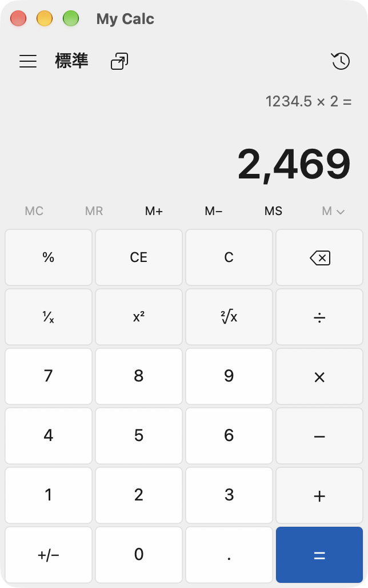

# My Calc

[Português (Brasil)](../../README.md) · [English](en.md) · [Español](es.md) · [Français](fr.md) · [Deutsch](de.md) · [Italiano](it.md) · **日本語** · [한국어](ko.md)

**My スイート:** [My Explorer](https://github.com/leoars/my-explorer/blob/main/README.ja.md) · [My Notepad](https://github.com/leoars/My-Notepad/blob/main/docs/readme/ja.md) · [My Paint](https://github.com/leoars/my-paint/blob/main/docs/readme/ja.md) · **My Calc**

macOS 用のシンプルな計算機です。標準、関数電卓、プログラマの各モードで、使い慣れたキーとショートカットを使って計算できます。

## macOS 版のダウンロード

- **[Apple シリコン（M シリーズ）用をダウンロード](https://github.com/leoars/my-calc/releases/download/1.0/My-Calc-1.0-arm64.pkg)**
- **[Intel 用をダウンロード](https://github.com/leoars/my-calc/releases/download/1.0/My-Calc-1.0-x86_64.pkg)**

macOS 12 以降に対応しています。 [最新版を見る](https://github.com/leoars/my-calc/releases/latest)

My Explorer、My Notepad、My Paint、My Calc をまとめてインストールするには、[My スイートのインストーラ](https://github.com/leoars/my-suite/blob/main/docs/readme/ja.md)を使ってください。



## このプロジェクトについて

My Calc は、My Notepad や My Paint と同じ発想から生まれました。画面の隅に収まり、上に表示部、中央にメモリ、下にキーが並び、何も探さなくてもコンピュータのキーボードにそのまま応える計算機です。このプロジェクトは、その使い心地を Swift と AppKit で、外部の依存なしに実現します。演算は独自実装の 10 進演算なので、0.1 + 0.2 は 0.3 になります。キー、表示部、アイコンはすべて新たに描き起こしたものです。

## 機能

### 標準

- 四則演算、**%**、**¹⁄ₓ**、**x²**、**²√x**、**+/−**。キーを押した順に計算するので、`1 + 2 × 3 =` は 9 になります。
- **=** をもう一度押すと直前の演算を繰り返します。演算子のすぐあとに別の演算子を押すと、置き換わります。
- **⌫** は最後の桁を消し、**CE** は数値を、**C** は計算全体を消去します。
- 計算中の式は数値の上の行に表示され、結果が出たあともそこに残ります。

### 関数電卓

- 演算子の優先順位と括弧に従います。`1 + 2 × 3 =` は 7 になります。
- **三角関数**：sin、cos、tan、sec、csc、cot とその逆関数、双曲線関数。角度は度、ラジアン、グラード（**DEG**、**RAD**、**GRAD**）から選べます。
- **x²**、**²√x**、**xʸ**、**10ˣ**、**log**、**ln**。**2ⁿᵈ** を使うと **x³**、**³√x**、**ʸ√x**、**2ˣ**、**logᵧx**、**eˣ** になります。
- **n!**（整数でない数にも使えます）、**|x|**、**π**、**e**、**mod**、10 の指数を入力する **exp**。
- **関数**：⌊x⌋、⌈x⌉、rand、10 進の度と度・分・秒との変換。
- **F-E** は結果を指数表記で表示します。


### プログラマ

- 数値は **HEX**、**DEC**、**OCT**、**BIN** で同時に表示されます。いずれかの行をクリックすると、入力に使う基数を選べます。
- ワード長は 64、32、16、8 ビット（**QWORD**、**DWORD**、**WORD**、**BYTE**）で、2 の補数で扱います。
- **<<**、**>>** と **ビット演算** メニュー（AND、OR、NOT、NAND、NOR、XOR、RoL、RoR）。優先順位と括弧に対応しています。
- キーの代わりに数値の 64 ビットを表示するパネル。ビットをクリックすると反転します。


### メモリと履歴

- **MS** は数値をリストに保存します。**MR** は最新の数値を呼び出し、**M+** と **M−** はその数値に加算・減算し、**MC** はリストを空にします。**M** はキーの上にリストを開き、数値をクリックするとその数値が戻ります。
- 時計のボタン（`Ctrl+H`）は、標準モードと関数電卓モードで行った計算の履歴を、それぞれの結果とともに開きます。行をクリックするとその結果が戻り、ゴミ箱でリストを消去できます。
- **コピー** は表示部の数値をコピーします。**ペースト** はクリップボードの内容を入力します。ピリオドやカンマを使った数値でも、`2+3*4=` のような計算全体でもかまいません。

### 数値

- 表示部の有効桁数は 32 桁の 10 進演算。0.30000000000000004 のような結果にはなりません。
- 10 の 10000 乗までの数を扱えます。32 桁に収まらないものは指数表記で表示します。
- 正確な値は正確に出ます。30° の正弦は 0.5、1000 の対数は 3、2 の平方根の 2 乗は 2 です。
- 桁区切りと小数点は、お住まいの地域の記号で表示します。桁区切りはオフにできます。
- エラーは何が起きたかを示します。0 による除算、定義されていない結果、無効な入力、オーバーフロー。

### インターフェイスと言語

- 3 本線のボタンでモードを切り替え、**設定…** を開けます。同じコマンドは macOS のメニューバーにもあります。
- システムに合わせたライトまたはダークの外観と、サイズを変えられるウインドウ。キーもウインドウに合わせて大きくなります。
- **常に手前に表示** にすると、計算機がほかのウインドウより手前に表示されたままになります。
- モード、角度の単位、桁区切り、ウインドウの位置を記憶します。
- ポルトガル語、英語、スペイン語、フランス語、ドイツ語、イタリア語、日本語、韓国語に対応しています。
- My Calc メニューの **アップデートを確認…** と、起動時の確認（1 日に 1 回まで）。起動時の確認は **設定…** でオフにできます。新しいバージョンは同意したときだけダウンロードされ、開発者の署名と Apple の公証を確認してから macOS のインストーラで開きます。インストーラを閉じると My Calc がもう一度開きます。

### ショートカット

テンキーといつものキーがそのまま使えます。メニューのコマンドは `Cmd` を使います。

| キー | 操作 |
| --- | --- |
| `0`–`9` · `,` または `.` · `+` `-` `*` `/` | 数字、小数点、演算 |
| `Enter` または `=` · `Backspace` · `Delete` · `Esc` | イコール、1 桁削除、CE、C |
| `F9` · `R` · `Q` · `@` · `%` | 符号の切り替え、¹⁄ₓ、x²、²√x、パーセント |
| `Ctrl+L` · `Ctrl+R` · `Ctrl+M` · `Ctrl+P` · `Ctrl+Q` | MC、MR、MS、M+、M− |
| `Option+1` 〜 `Option+3`（または `Cmd+1` 〜 `Cmd+3`） | 標準、関数電卓、プログラマ |
| `Ctrl+H`（または `Cmd+Y`） · `Ctrl+Shift+D` | 履歴を開く、履歴を消去 |
| `Cmd+C` · `Cmd+V` · `Cmd+T` | コピー、ペースト、常に手前に表示 |
| `S` · `O` · `T` · `U` · `I` · `J` | sin、cos、tan、sec、csc、cot。`Shift` を押すと逆関数 |
| `Ctrl+S` · `Ctrl+O` · `Ctrl+T` | sinh、cosh、tanh |
| `N` · `Ctrl+N` · `L` · `Ctrl+G` | ln、eˣ、log、10ˣ |
| `#` · `Y` · `Ctrl+B` · `Ctrl+Y` · `!` | x³、xʸ、³√x、ʸ√x、n! |
| `P` · `E` · `X` · `D` · `M` · `V` · `(` `)` | π、e、exp、mod、度・分・秒、F-E、括弧 |
| `\|` · `[` · `]` | \|x\|、⌊x⌋、⌈x⌉ |
| `F3` · `F4` · `F5` | DEG、RAD、GRAD（関数電卓） |
| `F5` · `F6` · `F7` · `F8` | HEX、DEC、OCT、BIN（プログラマ） |
| `F12` · `F2` · `F3` · `F4` | QWORD、DWORD、WORD、BYTE（プログラマ） |
| `&` · `\|` · `^` · `~` · `.` · `,` | AND、OR、XOR、NOT、NAND、NOR（プログラマ） |
| `<` · `>` · `J` · `K` · `%` | <<、>>、RoL、RoR、割り算の余り（プログラマ） |

## My スイートの一員

My Calc は My スイートのひとつです。My スイートは、使い慣れたメニューとショートカットを備えた、シンプルでわかりやすい macOS 用のアプリ群です。

- **My Calc**（このリポジトリ）：シンプルな計算機。
- **[My Explorer](https://github.com/leoars/my-explorer/blob/main/README.ja.md)**：フォルダツリー、タブ、コマンドバーを備えたファイルマネージャ。
- **[My Notepad](https://github.com/leoars/My-Notepad/blob/main/docs/readme/ja.md)**：シンプルなテキストエディタ。
- **[My Paint](https://github.com/leoars/my-paint/blob/main/docs/readme/ja.md)**：シンプルな画像エディタ。
- **[My Suite](https://github.com/leoars/my-suite/blob/main/docs/readme/ja.md)**：4 つのアプリをまとめたインストーラ。インストールするアプリを選べます。

## Mac でのビルドとインストール

インストーラは、Apple シリコンと Intel の macOS 12 以降を対象にしています。ビルドには、Swift コンパイラを含む Apple の開発ツールを使います。プロジェクトのルートで次を実行します。

```sh
./build.sh
open "My Calc.app"
```

自動テストを実行するには：

```sh
./test.sh
```

2 種類のインストーラを作るには、次のコマンドを実行します。`dist/` で、Apple シリコンには `arm64`、Intel には `x86_64` のパッケージを選びます。`.pkg` ファイルを開くと、アプリが `/Applications` にインストールされます。

```sh
./package.sh
```

アイコンは `Tools/icon.swift` のコードで描かれます。作り直すには `swift Tools/icon.swift Resources/MyCalc.icns` を実行します。

## コントリビュート

計算エンジンは [Sources](../../Sources) にあり、インターフェイスから分離されています。`BigDecimal.swift`（10 進数）、`BigMath.swift`（関数）、`Calculator.swift`（キー）です。テストは [Tests](../../Tests) にあり、[翻訳](../../Resources) は言語ごとの `.lproj` フォルダにあります。誤った結果を報告するときは、macOS のバージョン、モード、押したキーの順序、表示部に出た内容を添えてください。

## ライセンス

本プロジェクト独自のコードと文書には [Apache License 2.0](../../LICENSE) が適用されます。[THIRD_PARTY_NOTICES.md](../../THIRD_PARTY_NOTICES.md) をご覧ください。
