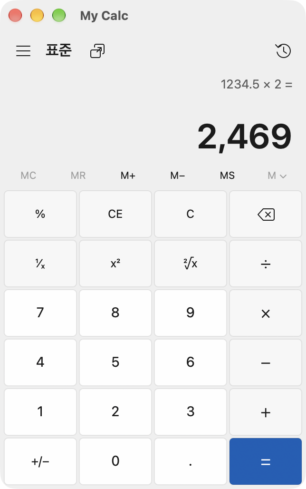
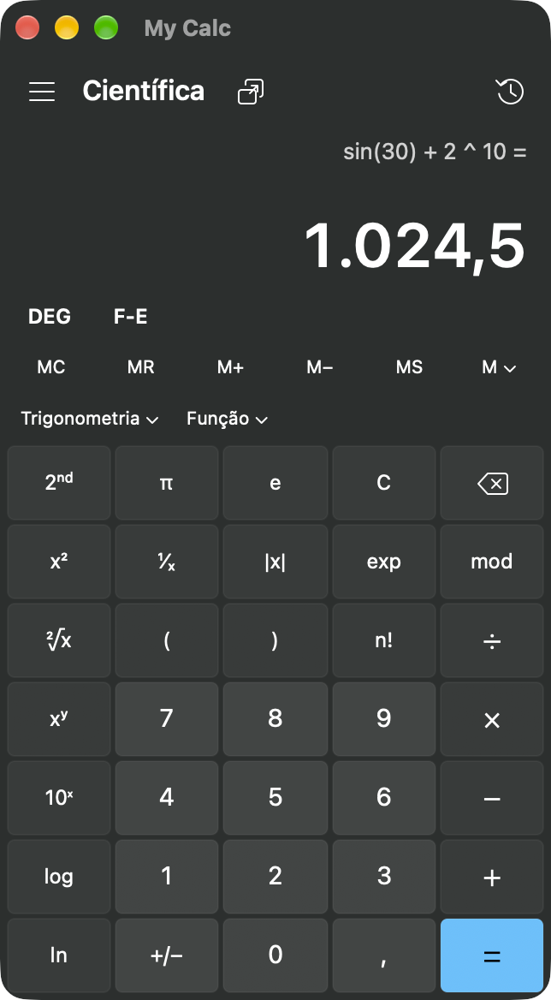

# My Calc

[Português (Brasil)](../../README.md) · [English](en.md) · [Español](es.md) · [Français](fr.md) · [Deutsch](de.md) · [Italiano](it.md) · [日本語](ja.md) · **한국어**

**My 스위트:** [My Explorer](https://github.com/leoars/my-explorer/blob/main/README.ko.md) · [My Notepad](https://github.com/leoars/My-Notepad/blob/main/docs/readme/ko.md) · [My Paint](https://github.com/leoars/my-paint/blob/main/docs/readme/ko.md) · **My Calc**

macOS용 간단한 계산기입니다. 표준, 공학용, 프로그래머 모드에서 손에 익은 키와 단축키로 계산하세요.

## macOS용 다운로드

- **[Apple Silicon(M 시리즈)용 다운로드](https://github.com/leoars/my-calc/releases/download/1.0/My-Calc-1.0-arm64.pkg)**
- **[Intel용 다운로드](https://github.com/leoars/my-calc/releases/download/1.0/My-Calc-1.0-x86_64.pkg)**

macOS 12 이상이 필요합니다. [최신 릴리스 보기](https://github.com/leoars/my-calc/releases/latest)

My Explorer, My Notepad, My Paint, My Calc를 한 번에 설치하려면 [My 스위트 설치 프로그램](https://github.com/leoars/my-suite/blob/main/docs/readme/ko.md)을 사용하세요.



## 이 프로젝트를 만든 이유

My Calc는 My Notepad, My Paint와 같은 생각에서 시작했습니다. 화면 한구석에 들어가고, 위에는 표시 창, 가운데에는 메모리, 아래에는 키가 있으며, 아무것도 찾을 필요 없이 컴퓨터 키보드에 바로 반응하는 계산기입니다. 이 프로젝트는 그 작업 방식을 외부 의존성 없이 Swift와 AppKit으로 구현합니다. 연산은 직접 구현한 십진 연산이어서 0.1 + 0.2는 0.3이 됩니다. 키, 표시 창, 아이콘은 모두 처음부터 새로 그렸습니다.

## 기능

### 표준

- 사칙연산, **%**, **¹⁄ₓ**, **x²**, **²√x**, **+/−**. 키를 누른 순서대로 계산하므로 `1 + 2 × 3 =`은 9가 됩니다.
- **=** 을 다시 누르면 마지막 연산을 반복합니다. 연산자 바로 뒤에 다른 연산자를 누르면 바뀝니다.
- **⌫** 는 마지막 숫자를 지우고, **CE**는 숫자를, **C**는 계산 전체를 지웁니다.
- 진행 중인 계산은 숫자 위의 줄에 나타나고, 결과가 나온 뒤에도 그대로 남습니다.

### 공학용

- 연산자 우선순위와 괄호를 따릅니다. `1 + 2 × 3 =`은 7이 됩니다.
- **삼각법**: sin, cos, tan, sec, csc, cot와 그 역함수, 쌍곡선 함수. 각도는 도, 라디안, 그라드(**DEG**, **RAD**, **GRAD**) 중에서 고릅니다.
- **x²**, **²√x**, **xʸ**, **10ˣ**, **log**, **ln**. **2ⁿᵈ** 를 쓰면 **x³**, **³√x**, **ʸ√x**, **2ˣ**, **logᵧx**, **eˣ** 가 됩니다.
- **n!**(정수가 아닌 수에도 쓸 수 있습니다), **|x|**, **π**, **e**, **mod**, 그리고 10의 지수를 입력하는 **exp**.
- **함수**: ⌊x⌋, ⌈x⌉, rand, 그리고 십진 도와 도, 분, 초 사이의 변환.
- **F-E**는 결과를 지수 표기로 보여 줍니다.



### 프로그래머

- 숫자가 **HEX**, **DEC**, **OCT**, **BIN**으로 동시에 표시됩니다. 줄 하나를 클릭하면 입력할 진법을 고릅니다.
- 워드 크기는 64, 32, 16, 8비트(**QWORD**, **DWORD**, **WORD**, **BYTE**)이며 2의 보수로 처리합니다.
- **<<**, **>>** 와 **비트 연산** 메뉴(AND, OR, NOT, NAND, NOR, XOR, RoL, RoR). 우선순위와 괄호를 지원합니다.
- 키 자리에 숫자의 64비트를 보여 주는 패널. 비트를 클릭하면 반전됩니다.


### 메모리와 기록

- **MS**는 숫자를 목록에 저장합니다. **MR**은 가장 최근 숫자를 불러오고, **M+** 와 **M−** 는 그 숫자에 더하고 빼며, **MC**는 목록을 비웁니다. **M**은 키 위에 목록을 열고, 숫자를 클릭하면 그 숫자를 다시 가져옵니다.
- 시계 버튼(`Ctrl+H`)은 표준 모드와 공학용 모드에서 한 계산의 기록을 각각의 결과와 함께 엽니다. 줄을 클릭하면 그 결과를 다시 가져오고, 휴지통은 목록을 지웁니다.
- **복사하기**는 표시 창의 숫자를 복사합니다. **붙이기**는 클립보드에 있는 내용을 입력합니다. 마침표나 쉼표를 쓴 숫자든 `2+3*4=` 같은 계산 전체든 상관없습니다.

### 숫자

- 표시 창에 유효 숫자 32자리를 보여 주는 십진 연산. 0.30000000000000004 같은 결과는 나오지 않습니다.
- 10의 10000제곱까지의 수를 다룹니다. 32자리에 들어가지 않는 수는 지수 표기로 나타납니다.
- 정확한 값은 정확하게 나옵니다. 30°의 사인은 0.5, 1000의 로그는 3, 2의 제곱근의 제곱은 2입니다.
- 자릿수 구분과 소수점은 사용 지역의 기호로 표시합니다. 자릿수 구분은 끌 수 있습니다.
- 오류는 무슨 일이 있었는지 알려 줍니다. 0으로 나누기, 정의되지 않은 결과, 잘못된 입력, 오버플로.

### 인터페이스와 언어

- 세 줄 버튼으로 모드를 바꾸고 **설정…** 을 엽니다. 같은 명령이 macOS 메뉴 막대에도 있습니다.
- 시스템에 맞춘 라이트 또는 다크 모드와 크기를 조절할 수 있는 윈도우. 키도 윈도우와 함께 커집니다.
- **항상 위에 유지**는 계산기를 다른 윈도우 위에 둡니다.
- 모드, 각도 단위, 자릿수 구분, 윈도우 위치를 기억합니다.
- 포르투갈어, 영어, 스페인어, 프랑스어, 독일어, 이탈리아어, 일본어, 한국어를 지원합니다.
- My Calc 메뉴의 **업데이트 확인…** 과 앱을 열 때의 확인(하루 최대 한 번). 앱을 열 때의 확인은 **설정…** 에서 끌 수 있습니다. 새 버전은 동의할 때만 다운로드되고, 개발자 서명과 Apple 공증을 확인한 뒤 macOS 설치 프로그램에서 열립니다. 설치 프로그램을 닫으면 My Calc 앱이 다시 열립니다.

### 단축키

숫자 키패드와 늘 쓰던 키가 그대로 동작하며, 메뉴 명령은 `Cmd`를 사용합니다.

| 키 | 동작 |
| --- | --- |
| `0`–`9` · `,` 또는 `.` · `+` `-` `*` `/` | 숫자, 소수점, 연산 |
| `Enter` 또는 `=` · `Backspace` · `Delete` · `Esc` | 등호, 숫자 하나 지우기, CE, C |
| `F9` · `R` · `Q` · `@` · `%` | 부호 바꾸기, ¹⁄ₓ, x², ²√x, 퍼센트 |
| `Ctrl+L` · `Ctrl+R` · `Ctrl+M` · `Ctrl+P` · `Ctrl+Q` | MC, MR, MS, M+, M− |
| `Option+1` ~ `Option+3`(또는 `Cmd+1` ~ `Cmd+3`) | 표준, 공학용, 프로그래머 |
| `Ctrl+H`(또는 `Cmd+Y`) · `Ctrl+Shift+D` | 기록 열기, 기록 지우기 |
| `Cmd+C` · `Cmd+V` · `Cmd+T` | 복사하기, 붙이기, 항상 위에 유지 |
| `S` · `O` · `T` · `U` · `I` · `J` | sin, cos, tan, sec, csc, cot. `Shift`와 함께 누르면 역함수 |
| `Ctrl+S` · `Ctrl+O` · `Ctrl+T` | sinh, cosh, tanh |
| `N` · `Ctrl+N` · `L` · `Ctrl+G` | ln, eˣ, log, 10ˣ |
| `#` · `Y` · `Ctrl+B` · `Ctrl+Y` · `!` | x³, xʸ, ³√x, ʸ√x, n! |
| `P` · `E` · `X` · `D` · `M` · `V` · `(` `)` | π, e, exp, mod, 도-분-초, F-E, 괄호 |
| `\|` · `[` · `]` | \|x\|, ⌊x⌋, ⌈x⌉ |
| `F3` · `F4` · `F5` | DEG, RAD, GRAD(공학용) |
| `F5` · `F6` · `F7` · `F8` | HEX, DEC, OCT, BIN(프로그래머) |
| `F12` · `F2` · `F3` · `F4` | QWORD, DWORD, WORD, BYTE(프로그래머) |
| `&` · `\|` · `^` · `~` · `.` · `,` | AND, OR, XOR, NOT, NAND, NOR(프로그래머) |
| `<` · `>` · `J` · `K` · `%` | <<, >>, RoL, RoR, 나눗셈의 나머지(프로그래머) |

## My 스위트의 일부

My Calc는 My 스위트에 속합니다. My 스위트는 익숙한 메뉴와 단축키를 갖춘, 간단하고 직관적인 macOS용 앱 모음입니다.

- **My Calc**(이 저장소): 간단한 계산기.
- **[My Explorer](https://github.com/leoars/my-explorer/blob/main/README.ko.md)**: 폴더 트리, 탭, 명령 모음을 갖춘 파일 관리자.
- **[My Notepad](https://github.com/leoars/My-Notepad/blob/main/docs/readme/ko.md)**: 간단한 텍스트 편집기.
- **[My Paint](https://github.com/leoars/my-paint/blob/main/docs/readme/ko.md)**: 간단한 이미지 편집기.
- **[My Suite](https://github.com/leoars/my-suite/blob/main/docs/readme/ko.md)**: 네 앱을 한데 모은 설치 프로그램으로, 설치할 앱을 고를 수 있습니다.

## Mac에서 빌드하고 설치하기

설치 프로그램은 Apple Silicon과 Intel의 macOS 12 이상을 대상으로 합니다. 빌드하려면 Swift 컴파일러가 포함된 Apple 개발 도구가 필요합니다. 프로젝트 루트에서 다음을 실행하세요.

```sh
./build.sh
open "My Calc.app"
```

자동 테스트를 실행하려면:

```sh
./test.sh
```

두 가지 설치 프로그램을 만들려면 아래 명령을 실행하세요. `dist/`에서 Apple Silicon에는 `arm64`, Intel에는 `x86_64` 패키지를 고릅니다. `.pkg` 파일을 열면 앱이 `/Applications`에 설치됩니다.

```sh
./package.sh
```

아이콘은 `Tools/icon.swift`의 코드로 그립니다. 다시 만들려면 `swift Tools/icon.swift Resources/MyCalc.icns`를 실행하세요.

## 기여하기

계산 엔진은 [Sources](../../Sources)에 있으며 인터페이스와 분리되어 있습니다. `BigDecimal.swift`(십진수), `BigMath.swift`(함수), `Calculator.swift`(키)입니다. 테스트는 [Tests](../../Tests)에 있고, [번역](../../Resources)은 언어별 `.lproj` 폴더에 있습니다. 잘못된 결과를 알릴 때는 macOS 버전, 모드, 누른 키의 순서, 그리고 표시 창에 나타난 내용을 함께 보내 주세요.

## 라이선스

이 프로젝트의 고유한 코드와 문서는 [Apache License 2.0](../../LICENSE)에 따라 배포됩니다. [THIRD_PARTY_NOTICES.md](../../THIRD_PARTY_NOTICES.md)를 참고하세요.
